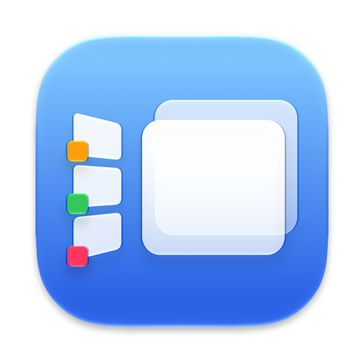

  <picture>
    <source srcset="docs/assets/app-icon-dark.png" media="(prefers-color-scheme: dark)">
    
  </picture>

<h1 align="center">Stage Manager</h1>

<a href="https://github.com/eugene-tea/stage-manager/releases/latest"><b>Download</b></a>
· free and open source · signed and notarized · Apple silicon, macOS 14 Sonoma or later 
or <code>brew install eugene-tea/tap/stage-manager</code>

## What it is

Stage Manager works and looks like the Stage Manager built into macOS. Your recent stages
wait as cards on the left, and the windows you are using stay in the middle, where you put
them. If you know Apple's, you already know this one.

It also adds what people have asked Apple for since 2022. None of it changes how Apple's
clicks, drags and keys work; if you never use it, it behaves exactly like Apple's.

- Your stages come back after a restart, in the same order.
- Hold Shift while opening an app to put it in the stage you are in, not a new one.
- Drop one card on another to combine the two stages.
- Switch stages, or send a window to one, from the keyboard (⌃⌥1–9, turned on in Settings).
- Keep the cards in your own order, or in your Dock's order (Settings).
- Keep windows clear of the strip, so the cards stay in view (Settings).

## More in the config file

Everything else is in one plain text file. An AI assistant can edit it for you, and Settings →
Advanced shows how.

- **Rules for new windows:** by app and title, a named stage, every stage, centred or cascaded.
- **Named stages:** names and numbers on the cards.
- **The strip:** width, size, tilt, an edge tab, above or below windows.
- **Motion:** every animation's timing, measured from Apple's.
- **More shortcuts:** new stage, pin a window, show or hide the strip.

## First launch

Turn off Apple's Stage Manager (the app offers to do it), then allow **Accessibility**,
which is required. **Screen Recording** is optional and puts live pictures of your windows on
the cards.

Everything about your windows stays on your Mac. It goes online only for a daily update
check on GitHub, which you can turn off.

## Learn more

- [Info page](https://eugene-tea.github.io/stage-manager/)
- [User guide](docs/GUIDE.md): install, use, settings, troubleshooting
- [Configuration reference](docs/CONFIG.md): every option
- [Accessibility](.github/ACCESSIBILITY.md): VoiceOver, the keyboard, Reduce Motion, and what's missing
- [Development](docs/DEVELOPMENT.md): build, test, release
- [Notes for AI agents](docs/AGENTS.md): for an assistant changing your settings
- [Changelog](CHANGELOG.md)

Stage Manager is an independent project, not affiliated with Apple. MIT licensed
([LICENSE](LICENSE)).
