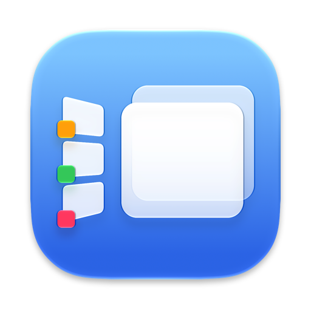

  <picture>
    <source srcset="docs/assets/app-icon-dark.png" media="(prefers-color-scheme: dark)">
    
  </picture>

<h1 align="center">Stage Manager</h1>

<a href="https://github.com/eugene-tea/stage-manager/releases/latest"><b>Download</b></a>
· signed and notarized · macOS 14 Sonoma or later

## What it does

- Looks and works like Apple's Stage Manager out of the box: the strip of stages on the
  left, floating windows in the middle, each at the size and place you gave it.
- Gives every Desktop its own stages and strip, and switches by click, ⌘-Tab or the Dock.
- Merges stages when you drop one card onto another, and lets you reorder the strip.
- Sends new windows where you want them with rules: a named stage, a new stage, or pinned to
  every stage.
- Offers keyboard shortcuts if you want them; nothing needs one.
- Keeps your stages across restarts, and never leaves a window hidden, even after a crash.
- Keeps every option in one config file, easiest changed by asking an AI assistant.

## First launch

Turn off Apple's Stage Manager (the app offers to do it), then allow **Accessibility**,
which is required. **Screen Recording** is optional and puts live window pictures on the cards.

Nothing about your windows leaves your Mac. The only network use is a daily update check
on GitHub.

## Learn more

- [Info page](https://eugene-tea.github.io/stage-manager/)
- [User guide](docs/GUIDE.md): install, use, settings, troubleshooting
- [Configuration reference](docs/CONFIG.md): every option
- [Development](docs/DEVELOPMENT.md): build, test, release
- [Notes for AI agents](docs/AGENTS.md): for an assistant changing your settings
- [Changelog](CHANGELOG.md)

Stage Manager is an independent project, not affiliated with Apple. MIT licensed
([LICENSE](LICENSE)).
