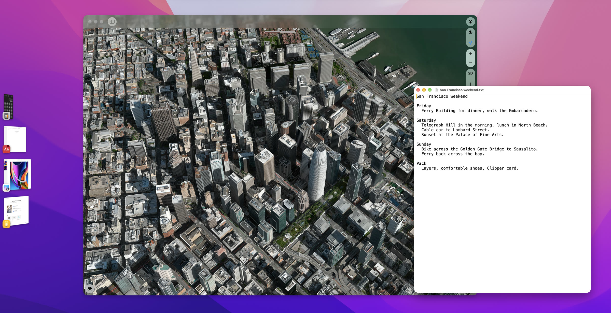

  <picture>
    <source srcset="docs/assets/app-icon-dark.png" media="(prefers-color-scheme: dark)">
    
  </picture>

<h1 align="center">Stage Manager</h1>

  
  
  

<a href="https://github.com/eugene-tea/stage-manager/releases/latest"><b>Download</b></a>
· free and open source · signed and notarized · Apple silicon, macOS 14 Sonoma or later 
or <code>brew install eugene-tea/tap/stage-manager</code>

## What it is

Stage Manager works and looks like the Stage Manager built into macOS. Recent stages wait as
cards on the left, and the windows in use stay in the middle, where they were put. Anyone who
knows Apple's already knows this one.

It also adds what people have asked Apple for since 2022. Apple's clicks, drags and keys work
the same with every addition; left unused, the app behaves exactly like Apple's.

- Stages come back after a restart, in the same order.
- An app opened with Shift held goes into the current stage.
- A card dropped on another combines the two stages.
- Stages can be switched, and windows sent to them, from the keyboard (⌃⌥1–9, turned on in
  Settings).
- Cards can be kept in a custom order or in the Dock's order (Settings).
- Windows can be kept clear of the strip, so the cards stay in view (Settings).

## More in the config file

Everything else is in one plain text file. An AI assistant can edit it, and Settings →
Advanced shows how.

- **Rules for new windows:** by app and title, a named stage, every stage, centred or cascaded.
- **Named stages:** names and numbers on the cards.
- **The strip:** width, size, tilt, an edge tab, above or below windows.
- **Motion:** every animation's timing, measured from Apple's.
- **More shortcuts:** new stage, pin a window, show or hide the strip.

## First launch

Apple's Stage Manager has to be turned off first (the app offers to do it). **Accessibility**
access is required. **Screen Recording** is optional and puts live pictures of the windows on
the cards.

Everything about the windows stays on the Mac. The app goes online only for a daily update
check on GitHub, which can be turned off.

## Learn more

- [Info page](https://eugene-tea.github.io/stage-manager/)
- [User guide](docs/GUIDE.md): install, use, settings, troubleshooting
- [Configuration reference](docs/CONFIG.md): every option
- [Accessibility](.github/ACCESSIBILITY.md): VoiceOver, the keyboard, Reduce Motion, and what's missing
- [Development](docs/DEVELOPMENT.md): build, test, release
- [Notes for AI agents](docs/AGENTS.md): for an assistant changing the settings
- [Changelog](CHANGELOG.md)

Stage Manager is an independent project with no affiliation to Apple. MIT licensed
([LICENSE](LICENSE)).
