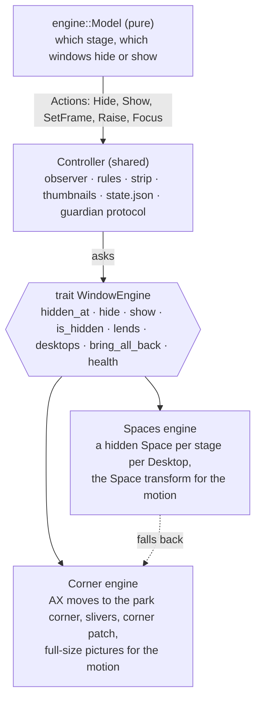
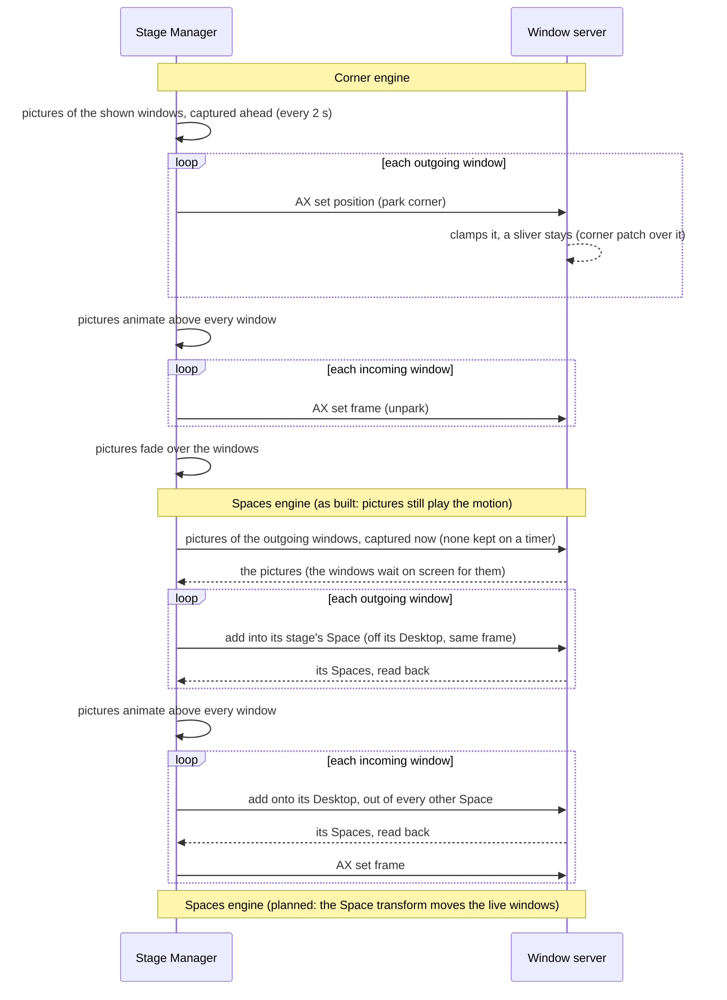

# Stage Manager — architecture

How the app is built and the rules the code keeps. What it should do for the user is in
[UX-SPEC.md](UX-SPEC.md); building and testing in [DEVELOPMENT.md](DEVELOPMENT.md); what is
still to do in [PLAN.md](../PLAN.md).

App: `Stage Manager.app`, bundle ID `dev.eugene.stagemanager`, `LSUIElement`, binary
`stage-manager`, crate `stage_manager`. A floating-window stage manager: Apple's strip and
floating windows, no tiling, no grids, no snapping; every window keeps the frame the user
gives it. The defaults look and behave like Apple's; every extra is off until configured.

## Architecture

```text
main thread (AppKit)          WM thread (CFRunLoop)            helpers
─────────────────────         ──────────────────────           ──────────────────────
NSApplication run loop        AXObservers (all apps)            capture: window server, SCK
status item + menu            AX reads/writes (timeout 0.25s)   config watcher (mtime poll)
strip NSPanels                engine::Model (owns state)        signal watcher (self-pipe)
Carbon hotkeys        ──cmd──▶ executes engine Actions          guardian process (parent death)
NSWorkspace notifications     persists state.json               ctl socket (testing/scripting)
              ◀──snapshot───  StripModel to main via GCD
```

- **Stages per screen and Space**, as Apple's (UX-SPEC "Screens"). Each screen has its own
  strip, Spaces, park corner (one with no screen beyond it, `engine::corner::park::choose_corner`)
  and capacity. A window belongs to the screen showing most of it (`engine::displays`);
  moved to another it starts a stage there (`Model::windows_moved_to_display`); a removed
  screen hands its stages to the main one (`Model::set_displays`). Screens are known by
  vendor, model and serial (`ScreenKey`), never `CGDirectDisplayID`, in the model and in
  `state.json`. `[displays] main_only` (read at launch) keeps the main screen only. Inactive
  stages are parked in their screen's corner. A switch saves the active stage's frames and
  z-order, parks it, restores the target's, raises, focuses the remembered key window last.
  Nothing acts on another Space's windows except the safety paths.
- **Spaces: the model's own ids.** No public API names a Space: each gets a synthetic id in
  the model. Under the Corner engine (and the Apple mode, or wherever the window server's
  listing cannot be read) a Desktop is recognized at `activeSpaceDidChangeNotification` from
  the window server's on-screen list; under the Spaces engine the listing names the Desktop
  each screen shows and each window's Desktops, bound to the model's ids ("The window
  server's Desktops", below). A window reaches the engine only once it shows on a display. A
  check on the tick (every 250 ms while something happens, every 2 s at rest) catches Space
  moves and missed notices. The Corner engine moves and hides no window through a SkyLight/CGS
  call; the Spaces engine does (below).
- **Layers, each with a private and a public way.** Hiding windows, picturing them, reading
  where they are and hearing what macOS does are separate layers. How windows are hidden is
  the engine's. Every other layer is the same under every engine: the window server's own
  call first, wherever a check finds it there and working, and the public one as the fallback
  (pictures today: "Window pictures", below; the reads and notices are still the Spaces
  engine's only: PLAN, "One way for every mode"). No technique is an engine's only because
  its call is private.
- **Engine is pure Rust** (`src/engine`, `src/config.rs`), unit tested: observations
  in, `Action`s out (`Hide`, `SetFrame`, `Raise`, `Focus`).
- **Platform layer** (`src/platform`): AX, CGWindowList, ScreenCaptureKit, Carbon hotkeys,
  NSWorkspace events, safety. Windows are moved and hidden through public APIs only, plus
  `_AXUIElementGetWindow`, under the Corner engine; the Spaces engine adds SkyLight's Space
  calls, loaded at run time. Window pictures ask the window server's own capture first under
  every engine and fall back to ScreenCaptureKit.
- **UI** (`src/ui`): status item and menu, Settings, a strip panel per screen (CALayer
  cards), the motion overlay (just below floating windows; above everything only while a
  dragged window's card shows).
- **Threads:** every AX call runs on the WM thread with a 0.25 s timeout; the main thread
  never calls AX. Apps that do not answer yet (a login, the launch's recovery scan) are
  asked on threads of their own, so one busy app holds up no other; so are the parks of
  Mission Control's lends under the Spaces engine (a thread per app, the WM thread waiting
  for all within one deadline, then making the window-server calls itself). The minimize tap
  (`platform::minimize_tap`) asks on its own thread too, at 0.1 s a call and only for a press
  near a managed window's title-bar buttons or ⌘M: a minimize caught there goes to the WM
  thread as a command. Frame writes run with
  the app's `AXEnhancedUserInterface` off (`platform::enhanced_ui`), on again after (also at
  quit, panic and SIGABRT). A late activation notice acts only if it fired after our latest
  switch began and its app is still frontmost (`engine::stale_activation`). A handle answering `kAXErrorInvalidUIElement` is looked up
  afresh by id; one unlisted and off screen on two looks a second apart is let go as closed
  (`engine::stale_handle`). Commands go main → WM by channel plus `CFRunLoopPerformBlock`;
  snapshots WM → main via GCD.
- **A switch's states** (round r6-waits): planned; under the Spaces engine the outgoing
  windows' pictures taken (`switch_pictures`, 160 ms at most); the transition sent to the
  strip and the activation's keyboard routed at once; the strip's answer waited for on the
  WM thread (`strip_model::wait_cover`, a condvar, `COVER_TIMEOUT` 150 ms; no answer: the
  windows move at once and the strip, told so, draws nothing), then `[animation] cover_ms`
  (20 ms) for the pictures to reach the screen; the hides run and the arrivals are held
  (`pending`, the phase's `Switching`) until the strip's `Unveil`, the backstop at the tick,
  or an event that lands or supersedes them (`flush_pending_as`); the landing's batch; then
  the raise-order check (`controller::raise_order`): a state, read on the fast tick 4 ms
  apart until the order holds for 60 ms (150 ms after a fix) or 400 ms pass, the WM thread
  handling its notices between reads; the user's click, another window in front, or a
  later batch that stacks or moves its windows ends it. The cover wait still blocks: the
  handlers that start a switch go on after it as if its batch had run (an un-minimize's
  dive frame, a new window's release from the engine, an activation's lend decided, the
  tick's and the fast tick's later duties, the next events of the same run), so making it a
  state means making each of those a continuation run at the cover's end.
- **Time:** one clock, every event stamped at receipt, and five rules for what time may
  decide (below, "How time is used").
- **Who caused a notice** (review 11-21, R1): macOS never says. Order decides where it can,
  time only expires what never came. Each action of ours registers what it expects in the
  cause ledger (`engine::causes`): a focus or raise a focus of that window, kept per app in
  the order asked (an app tells its focus changes in order); a frame set a move to that
  frame (the window where our set put it, or the first answer to a set, clamped); an
  `AXFrontmost` the app's activation. The user's presses are kept there too, with the
  window pressed (a hit-test in the window list read for the press): a press on a window
  makes its next focus theirs at once. A press on the desktop expects Finder's first
  activation and first focus (`engine::desktop_echo`). A focus or activation notice is then
  judged by one pure function over the facts gathered for it (`engine::attribution`: the
  gates in one written order, a table of where the two notices differ;
  `controller/notices.rs` gathers and does what the verdict says). What still goes by
  time, each named in `engine::causes`' module doc: a focus after a key press
  (`USER_FOCUS`), macOS's own activation after a display change (`DISPLAY_SETTLE`), a
  window just shown counted as carried by our switch at a Space change (`SLIDE_CARRY`),
  the echo window (`[windows] focus_echo_ms`) for a notice beyond those expected and for
  "the window list may not show our write yet", and the caps.
- **The WM tick** (`engine::tick_pace`): the duties no event announces (a window closed or
  an app gone with no notice, the Space check, the engine's upkeep, the debounced save, the
  config poll, the controller's own deadlines) run on one timer, every 0.25 s for 3 s after
  any event that may change windows (an AX notice other than a title change, a workspace
  notice, a click, a key with ⌘, ⌥ or ⌃, any strip, hotkey, display or ctl command) and
  while a duty waits on it (`Controller::tick_waits` and the observer's and the thread's
  own: a switch, a save due, a window counted missing, a stray parked again, a deadline),
  else every 2 s. The Corner engine caps the rest at 0.75 s while the inert slivers' tap
  judges presses (it trusts the tick's list for a second). Every duty runs at every tick,
  so nothing is missed, only caught up to a rest later when nothing happens; at rest every
  tick is a full pass. The tick's duties share one read of each window list
  (`windows::wake`), read again after any window write of ours. `ctl state`'s `tick`
  counts brisk and rest ticks.
- **Idle subsystems** (1.9): what a mode has no use for does not run. The Apple mode and the
  stand-down run no controller of ours (no Dock order, corner upkeep, lock poll or park
  checks); the Apple mode's closed-window sweep runs only on the list its mirror read in
  that tick. The event taps (`platform::tap_switch`) are on only while they have something
  to catch: the inert slivers' while windows are parked with the shield on, the minimize
  tap's while the WM thread arranges and `minimize_to_strip` holds, Mission Control's key tap
  while the Spaces engine arranges with `mission_control_stages` not `"off"`. With no strip showing
  cards (hidden, or standing down) the strip lets go of the mouse moves' monitor and the
  card glass reads no wallpaper; capture workers with no targets sleep until given work.
  The Dock order's running-app paths are asked of LaunchServices after a launch or a quit
  (`dock::running_by_path`). `ctl state`'s `costs` counts window list queries,
  LaunchServices calls, Dock reads, captures, wallpaper reads, lock polls, tap events and
  mouse moves since the launch.

## How time is used

macOS says neither who caused a notice nor when most state changes, so time stays in the
app; what the code keeps is how it is used (review 11-21). Five rules, the same in every
flow:

1. **Order decides cause.** "The first X after Y with nothing between", never "within X of
   Y". Each action of ours registers what it expects in the cause ledger (`engine::causes`;
   "Who caused a notice", above); a wallpaper press expects Finder's first activation and
   focus after it (`engine::desktop_echo`); the Apple mode tells its own activations the
   same way (`engine::apple::cause`). Time is only each expectation's expiry.
2. **Notices are stamped at receipt.** One clock, `platform::clock::now()`; under
   `cfg(test)` a per-thread clock a test freezes and moves (`clock::test::freeze`,
   `advance`), and since a wait on the WM thread goes through `clock::sleep` and a deciding
   age through `clock::since`, a wait under a frozen clock moves the clock on and ends.
   Every event carries when it came from macOS: the AX callback's entry, the NSWorkspace or
   input monitor's handler, an event tap's callback, the window server's notice callback
   (`observe::Stamped`, `InputEvent::heard`, `WmCommand::SpaceChanged`'s instant; the
   controller keeps the one being handled, `received`). An age is counted from that stamp,
   never from when the busy WM thread got to it; a stamp older than the action counts as at
   it and is counted (`predated`). A deadline keeps the clock's now.
3. **A wait names what ends it, and its cap.** The read that confirms, the events that
   refute, and a cap that ends only what never came: `engine::lend_wait` for the Dock's and
   ⌘Tab's lends (the app's activation and its switch confirm; another app's activation, a
   press that was no click, Escape at the key tap refute), the Apple mode's wait for Apple's
   answer (`engine/apple/mirror.rs`, `Expect`), the raise-order check, `FLIP_WAIT`. A wait
   ended by its cap says so.
4. **Quiet is read, not assumed.** Where something settles, the thing itself is read until
   it holds, in place of a fixed time after a notice: the Apple mode's motion at rest (two
   still reads), the Desktop shown read from the window server's listing in place of the
   windows on screen, Mission Control's freeze ended by the look that finds macOS's window
   and the Dock's cover gone. A window-server notice only brings such a read forward ("The
   window server's notices", below).
5. **Every time decision logs its margin.** `engine::margin` notes each decision by a time
   window and each wait's end by its constant's name: how far into its limit, which way it
   was judged, whether its cap or a notice ended it. `log summary` and `ctl state`'s
   `margins` then say, per Mac, which values come near their limit (DEVELOPMENT, "Time
   values that came close").

**The bench** (`platform/controller/bench.rs`; DEVELOPMENT, "The bench") runs the real
controller, observer and engine on a fake desk and a frozen clock, each dated incident a
scenario at load 1, 3 and 10: the load multiplies every notice's delay and every platform
call's cost, while macOS's own animations keep their length. **The load table**
(`cargo test --lib load_table -- --nocapture`) gives each scenario's outcome at each load
and the time limits crossed only under load. A row the same at every load is decided by
order; a row that changes names the time value that decides it, where a slower Mac may see
something else. A limit crossed with the outcome unchanged is a margin, not a fault.

Rightly a plain time: Apple's own timings that are copied (the click hold, motion lengths,
the Apple mode's gesture choreography), the person's stillness in the Apple mode's gate,
paces, backoffs and keep-for-days policies. What still decides by time where order could
is in PLAN, "Under the hood".

## Window engines (1.9, in progress)

How a stage's windows are hidden, shown and animated is one strategy with two
implementations. The **Corner engine** is today's: Accessibility moves to the park corner,
pictures for the motion. The **Spaces engine** puts each inactive stage in a hidden Space of
the window server's own. Everything else is written once and reaches the engine through
the trait and two doors, the model's and the upkeep's (below); a few places outside them
still ask which engine runs.
The Corner engine is the default. `[windows] engine` (read at launch,
`engine::engine_choice`) has two values: `"accessibility"`, the default, runs the Corner
engine and never probes; `"spaces"` runs the launch probe and the Spaces engine when it
passes, else the Corner engine, and the Corner engine for the rest of a run whose checks
fail. The two are measured side by side by `scripts/measure_engines.py` (UX-SPEC, "Window
engines measured").
The live suite's test switch (`STAGE_MANAGER_ENGINE=spaces|corner`, honoured with
`STAGE_MANAGER_ONLY` only) comes ahead of the config.



**The Apple mode** (`[windows] apple_stage_manager_on = "integrate"`) is what the app does while Apple's
Stage Manager is on, in place of standing down: a third engine that hides nothing
(`platform/apple/engine.rs`, `EngineKind::Apple`; a third arm in the model's door and in the
controller's upkeep door, the trait unchanged), and a second conductor beside the controller
(`platform/conductor.rs`: the WM thread holds a `Conductor`, `Ours(Controller)` or
`Apples(AppleController)`). The mode's pure half (`engine/apple`) reads Apple's arrangement
from the window list and WindowManager's Accessibility (`mirror.rs`), keeps the model in step
with the model's own ops, their actions dropped (`follow.rs`), plans what is asked into jobs
(`plan.rs`, `job.rs`: goals met one step at a time against the mirror as it is at each read)
for routes Apple's answers to (`platform/apple/routes`: focus, Shift-click, drag), every
posted step through the gate (`gate.rs`: never while the user's button is down, keys are
held, the pointer moved, nor mid-motion), all of it run in the tests against a fake
WindowManager (`engine::testkit::apple`). The posted gestures run on a thread of their own
(`platform/apple/post.rs`); a newly opened app the rules want here is hidden at its launch
(`platform/apple/launch_hide.rs`) so Apple's keeps the stage in front. The restore
(`engine/apple/restore.rs`) turns the saved stages into one job of a goal per stage; one
mirror per screen (`engine/apple/screens.rs` splits the window list and matches each
`sm.space`), Desktops not shown kept away in each mirror. Every strategy and route, with what it
costs and how it was measured: [STRATEGIES.md](STRATEGIES.md).

A switch in each engine:



Which engine runs is decided on every Mac at every launch, never by a list of macOS
versions:

```mermaid
stateDiagram-v2
    [*] --> Corner: [windows] engine = "accessibility" (no probe)
    [*] --> Probe: "spaces"
    Probe --> Spaces: the calls resolve, a trial Space with an own panel reads back
    Probe --> Corner: a step fails (the verdict logged either way)
    Spaces --> Spaces: every hide and show read back; a miss sent once more
    Spaces --> BringAllBack: still missed after the retry, or 3 misses set right within 60 s
    BringAllBack --> Corner: for the rest of the run; the hidden windows parked
```



The choice is pure (`engine/engine_choice.rs`: `choose` from the config, the
test switch and the probe's verdict; `Health`, the strikes in their window of time) and is
made in `main` once AppKit is up and before the WM thread starts
(`window_engine::choose_at_launch`). The probe (`platform/spaces/probe.rs`) looks up the
calls, orders in a 4-point transparent panel of the app's own far off every screen (its
order-in flushed: AppKit sends it with the run loop's transaction otherwise, and the run
loop has not run yet), makes a classic Space, adds the panel into it and reads it back
hidden, adds it back onto its Desktop with the show's mask and reads it back, ends the
Space and closes the panel; each step bounded at 40 ms, the first that does not read back
is the reason. `ctl state` `engine` says `kind`, `why`, `probe` (ok, reason, ms, each step's
ms) and `fallback`. The fallback runs on the WM thread at the tick after the engine failed
(never while a switch's windows wait behind their pictures, never during a quit,
`controller/fallback.rs`): the failed engine's `bring_all_back` (the Spaces engine's sweep;
windows a refusing window server leaves in a stage Space come out by ending that Space with
the classic call, which needs no bridge), `window_engine::fall_back` installs the Corner
engine and records why, the controller takes the new engine, the model's answers follow
(`Model::set_engine`), the parked file is written again, and the windows the model counts
hidden on a Desktop shown are parked (those on another Desktop when it shows, as always).
What the bring-back could not bring out is swept again from the tick every two seconds until
no window is held or owed and no stage Space is left, and a failed Spaces engine holds no new
window for a launch's watch. `ctl debug-engine-fail next|hide|show|all` (test only) drives it
in the live suite's `engine` phase.

Quit, a crash (the guardian), a logout and a stand-down use the same `bring_all_back`
whichever engine runs. Each choice and fallback is logged with its reason. The parked file
of a Spaces run names its stage Spaces with their Desktops (`ParkedFile::spaces`), only for
the log: the guardian starts once the app has ended, and they ended with it. Its engine takes
the app's screens from the file as the Corner engine's does (`assume`: the visible frame, the
corners, the other screens' zones), since a window parked at the corner for ⌘Tab's lend stays
there when the app ends; a registered window there is stranded by the park-zone rule under
either engine. Mission Control's lends park at the stages' cards instead (round
mc-card-park), on screen: the file names those frames (`ParkedFile::lends`), and a
registered window listed at one is stranded there (`ScanDisplays::at_lend`). A Spaces run's recovery scan also runs the Corner scan when an earlier copy
left registered windows, and in the guardian, so a Corner run that crashed with windows in
the park corner, or a lend's park, is brought back the Corner way under Spaces (the launch
scan is the Corner one under either engine). So are the windows the model first meets in the park corner later (a Desktop shown for
the first time since, a window an app reopens at a park frame it saved): a window first seen
is asked the park corner's questions under either engine (`Model::found_parked`,
`found_out_of_sight`, `safe_restore`), and the app's watch of windows taken from an old
guardian judges them by the park corner (`Watch::taken`): the copy that hid them is gone, and
its stage Spaces with it.

The seam: the model emits `Action::Hide { id }` and never a park frame, and asks every question about where hidden windows are through one door
(`engine/model/hiding.rs`), which asks the pure half of the engine that runs
(`ModelOptions::engine`; the Corner engine's is `engine::corner`, its geometry
`engine::corner::park`). The questions are of two kinds: is this listed window hidden now,
and may a window be brought back here. `platform::window_engine::WindowEngine` has
`hidden_at`, `hide`, `show`, `is_hidden`, and for safety `bring_all_back`,
`bring_back_briefly` (an abort), `bring_back_rest` (the last look at the window server's
list), `recover` (the recovery scan), `stranded` (is a window read at this frame still
hidden away) and `assume` (the guardian takes the app's parked file as its own knowledge),
with `platform::corner::engine::CornerEngine` and `platform::spaces::engine::SpacesEngine`
behind it; the rest of its methods have defaults the Corner engine keeps (the lends, the
window server's Desktops, the launch watch, the landing). A `SetFrame` is the
engine's `show`: the model counts the window shown either way, and the engine knows what it
has hidden. Every engine's switch plays with pictures: the controller plans the transition,
sends it to the strip, waits for its answer, hides behind the outgoing pictures and holds the
arrivals until the unveil. The engine is one value for the process
(`window_engine::current`), so the WM thread's batches and the safety paths on other threads
ask the same one. The parked file names the engine (left out for Corner), and the guardian
installs that engine before its first scan; its watch asks that engine whether a window is
still away.

What an engine keeps up on the WM thread around those calls is not behind the trait: it
reads and changes the controller's own state (the model, the phase, the observer). It goes
through a second door, `platform/controller/upkeep.rs`: every moment the shared code has
engine work at (a batch ended, the tick and the fast tick, a press released, a show or a
hide that failed, a window let go while hidden, a switch's cover, the shows still owed at
quit, `ctl state`) is one method there with one `match` on the engine that runs, the same
shape as the model's door. The Corner engine's answers are methods of the controller in
`platform/controller/corner/` (the corner patch and the desktop's still, the inert-slivers
shield, the park reconcile, the windows whose restore failed, the switch's corner cover) on
one struct of state, `CornerUpkeep`; no other file of the controller touches it. The Corner
engine's files: `engine/corner/` (pure), `platform/corner/` (the engine, the slivers tap),
`platform/controller/corner/` (its upkeep). A new window's placement before it shows is
three questions on the trait: `app_launched` (a launch notice), `about_to_show` (the window
is held on its way in, so the controller places it now) and `let_new_out` (placed: let it
show); the Corner engine answers nothing, never and nothing. The checks while running are the
trait's `health` (the Corner engine: never failed).

The Spaces engine as built (`platform/spaces/`: `ffi.rs`, SkyLight's calls loaded at run
time, nothing linked; `engine.rs`; its pure half `engine/spaces.rs`; its upkeep
`platform/controller/spaces.rs`). One window-server Space per stage per Desktop, made by the
classic call when the stage's first window hides there, so it belongs to this process: the
window server ends it with the process and its windows show again by themselves, after a
crash or a kill. A hide is the bridged add of the window into its stage's Space; a show is
the same add into the window's own Desktop (read from the window server when it hid) with
the mask that takes it out of every kind of Space, then the frame through Accessibility
when the window is not already at it (a hide does not move a window, so most shows ask the
app nothing, and a frozen app's window hides and shows all the same). The stage Space is
never shown. A hidden window keeps its frame and is listed off screen, so
no frame says "hidden" (`is_hidden` answers false, `stranded` too but for a registered window
at the park corner of ⌘Tab's lend) and the trait has one more
question, `present_off_screen`: the windows hidden on a Desktop that shows, which every count
of a Desktop's windows adds to the on-screen list (a window gone from the screen left its
Desktop; a hidden one did not). No return code is trusted: after every hide and show the
window's Spaces are read back, a miss is logged and counted (`ctl state`, `engine`), a show
that left a window hidden is owed and tried again by the tick (so is the frame a show asked
of a window parked for ⌘Tab's lend that it did not take), and on each tick (every 250 ms
while something happens, every 2 s at rest) the upkeep checks, by the window server's word,
that the windows the model counts hidden are the ones in stage Spaces (one that does not go
in is tried again, ever more slowly, up to 30 s apart), and every 10 s, or at the window
server's notice of a Space's change, lets out any window found in a stage Space that the
engine does not hold (at once for a window of an observed
app found there, one its app ordered out while hidden and in again).
Two things the window server does not say for a window in a stage Space, so the shared code
asks otherwise: a window its app closed without a notice is listed exactly as before, so the
dead-handle look takes in the hidden windows too; and macOS shows a window it un-minimizes
on the Desktop, out of any Space, so a minimized window on its way to the strip is put
beyond the Dock's edge first, as under the Corner engine, and hidden again once it is down. The
bring-backs (quit, a stand-down, a panic, an abort) ask the window server which windows are
in the engine's Spaces and move each onto its Desktop, from any thread, then end the Spaces;
the registry still gives fitted windows their frames back. The motion is still the
pictures, but none is kept fresh on a timer: the trait's
`pictures_at_switch` answers true, so the strip captures full-size pictures only as the
pointer nears a card, and the controller, before it sends a switch to the strip, captures
every outgoing window whose picture is not fresh (`platform/controller/switch_pictures.rs`,
through `platform/switch_shots.rs`: the window server's own capture a window at a time, any
window it misses through ScreenCaptureKit) and waits for them, 160 ms at most. The
windows stay on screen meanwhile and hide behind their pictures in one step each. A window
in a stage Space still draws and is captured with its current content, so an incoming
window's picture taken while it is hidden (the pointer on its card) is current too.

The window server's Desktops (design r3). The model names its Spaces by ids of its own; the
Spaces engine reads the window server's listing (`SLSCopyManagedDisplaySpaces`, through
`WindowEngine::desktops`: each screen's Space shown and its kind, its Desktops with their ids
and uuids; `spaces_of` for a window's Spaces; the Corner engine answers `None` to both). The
controller's one read is `Controller::listing()` (`platform/controller/desktops.rs`): `None`
when the engine reads none, a managed screen has no entry, or one names no Space shown or not
its kind. Each arrival is given its screen's Desktop, read again at the arrival, and the
Desktop and the model's Space are bound to each other (`engine/model/desks.rs`,
`Model::arrive_on`; one id, one Space). The bindings follow a relabel, go with a pruned or
merged Space and at a fallback, and are saved with their uuids (`state.json`'s `desks`; a
load logs how many the listing still has).

**The listing decides** while it can be read and a Desktop is bound
(`Controller::keyed_listing`; slices 2 and 3). The paths part on what could be read, never on
the engine's kind; with no listing each of these runs as before, by the windows on screen.

- *Which Desktop arrived, and on which screen.* Per screen, the listing's Space shown against
  the Desktop the model's Space there is bound to, and its kind (a Desktop, a full-screen
  app's Space) against what the controller counts (`desk_differences`). A difference is that
  screen's Space change; only the screens that differ arrive. The Space change's notice comes
  1-9 ms before the listing flips, so a notice that finds no difference waits for one on the
  fast tick (`Hold::Flip`, `flip_step`), `FLIP_WAIT` (300 ms, a cap; its margin is noted) at
  most, and is then a notice with no change: nothing arrives. Every look for missed changes
  and the window server's own notice of a change's end compare too (`sync_desktops`): a
  difference found there is taken at once, and NSWorkspace's notice, when it comes after,
  does nothing more (`announced_late`). The Space that arrives is the one bound to the
  Desktop; the model's vote over the windows on screen stands in only for a Desktop bound to
  none yet, among the Spaces bound to none.
- *Which windows are on it.* Each window of an arrival is asked for its Spaces
  (`keyed_live`, 22 µs each): one on another Desktop still listed (a Desktop sliding away, a
  window just shown elsewhere) is left out; one on two Desktops or more is on every Desktop;
  a known one of another Space was moved here; one the model counts hidden in another
  Desktop's stage that nothing lent is hidden again. So the arrival never waits for a list
  that shows one Desktop only, and nothing settles after it (`phase::Event::ArrivedRead`).
- *Where a window went.* At the tick, a window of a Desktop shown that is not on screen, or
  one of another Desktop that is, is asked for its Desktop once (`desk_membership`): on one
  other, it moved there (`Model::window_on_desk`); on its own or on none, nothing.
- *A window found, an activation.* A new window is placed only when it is on the Desktop the
  model shows (`found_on_desk_shown`); an activation whose app's focused window, unknown to
  the model, is on a Desktop not shown belongs to that Desktop's slide
  (`focus_on_another_desk`).

**What is still guessed, and where.** With no listing (the Corner engine, the Apple
mode, a listing that cannot be read): everything, as before (`MIXED_WAIT`, `SPACE_SETTLE`,
`FOREIGN_SETTLE`, `SPACE_CHECKS`, `BESIDE_ARRIVALS`, `STICKY_HOPS`, `SLIDE_CARRY`, the
display change's hold of new windows at an arrival); a guess made so is corrected at the
next good read, where the model's Space is bound to no Desktop or to another. With the
listing: the launch's first arrival (nothing is bound yet); a Desktop seen for the first
time (the vote among unbound Spaces, the saved Spaces, by their windows); that a slide is
under way before its end (`slide_hold`, from the window list, and the Mission Control
watch: the flip comes at the slide's end); a full-screen animation (a window covering the
display on a Desktop, `fullscreen::SETTLE_MAX`); Accessibility's silence at an arrival;
windows moved between screens and off every display (frames, `SPACE_CHECKS`); and what a
screen coming or going does to the model's Spaces (the adoption; `spill`'s watch for windows
let out).

**One record of a window's Desktop** (slice 4). The model owns it: a window's Space, through
the binding (`Model::desk_of`). The Spaces engine takes it at every hide
(`WindowEngine::hidden_at` notes the stage, the frame and that Desktop; `spill::home_for`:
the model's Desktop while the window server lists it, else where the window is, else where it
was hidden from, else the Desktop its own screen shows). The engine's own copy for each
window it holds (`Held.home`) serves the threads with no model (the sweep, a quit, a panic)
and is set to the model's wherever they differ (`SpacesEngine::rehome`, at the tick's check:
a map edit). A held window found out of its stage's Space, on any Desktop, shown or not, is
hidden again from the model's Desktop (`forget_escaped`, then the tick's hide). No clock
decides any of it: the engine's second record of the last Desktop, the change's 10 s settle
and the last press (`hide_home`, `MID_CHANGE`) are gone.

**A Desktop macOS ended** (the first step of slice 5). At the tick, while the listing
decides, a Desktop bound to a Space that no screen lists any more, for `spill::ENDED_AFTER`
with the display list still, has ended (`Controller::ended_desktops`): its Space joins the
Space of the Desktop its shown windows are on now (`spill::landed_on`), else of the Desktop
its screen shows, whole (`Model::desk_ended`, `Model::merge_space`: the half of the gone
screen's adoption that takes one Space into another), and the engine's homes follow. Still
the old way, by the windows and the clock: the adoption of a gone screen's Desktop into the
main screen's whether macOS kept that Desktop or not (`adopt_display`), `spill`'s watch and
its own choice of where an ended Desktop's stage Spaces are made again, the model's
`handed_hidden` and `display_watch`.

The shadow stays as the check: at each arrival and each look for missed changes
(`engine/desk_shadow.rs`) the Desktop the model says each screen shows is compared with the
listing's, and each held window's home with the model's Desktop for it; each disagreement is
logged once when it begins and once when it ends (`ctl state`'s `desks`). On the bench it
reads 0 on the Desktop shown in every scenario.

The window server's notices (round r5-notices, the Spaces engine only). The window server
tells a process that runs the AppKit event loop of some of its changes: a window created,
shown or hidden, added to or taken out of a Space, Mission Control's or App Exposé's open and
close, a Desktop change's end (UX-SPEC, "The window server's notices"). The launch registers
them before its probe when it may run the Spaces engine (`platform/spaces/notices.rs`,
`SLSRegisterNotifyProc`), forwards them once that engine is chosen and removes them
otherwise; under the Corner engine nothing is registered. The callback only stamps the notice
and copies its payload; the main run loop's next pass folds a turn's notices into one burst
per kind (`engine/server_notice.rs`), drops those of the engine's own adds (by the window
and the Space it asked, never by a time window) and sends the rest to the WM thread
(`WmCommand::ServerNotice`). **A notice is a trigger for a read, never a fact**: each brings
forward a look that a poll makes today (`platform/controller/server_notices.rs`): the look
for an overview, the check of the model against the window server, the check for a missed
Desktop change (and the launch watch's read at a window's creation, but that notice, 811, has
never reached the app: the launch watch rests on its own read, live 11-21). What the look finds decides; every poll stays as the
cap behind it, so a Mac whose window server sends none behaves as before. Which word of a
membership notice is the window and which the Space is read by content (the launch probe's
own panel, or a window the engine just showed); until then such a notice names nothing and
its look covers every window. `ctl state`'s `engine.notices` says `heard` once any registered
type came, `silent` when none came within 5 s of the launch probe (silent is no failure),
`never_heard` (the types that never came) and each type's counts,
and `margins` says per wait how often it ended at a notice's look (`noticed`), at the poll's,
or by its cap.

Window pictures (`platform/capture.rs`, `platform/capture_fast.rs`, 1.9): every capture asks
the window server first, one call a window and no listing (`SLSHWCaptureWindowList` for a
window within the displays, on screen or in a stage Space; `CGWindowListCreateImage` for one
partly off every display, a parked window), and ScreenCaptureKit only for a window that
source misses (the call missing, nothing handed back, a picture that cannot be the window),
for every picture of a call while it rests (its pictures of three windows came back blank
before any was the window: 30 min, then it is tried again), for the capture gate's probe (the
first capture of a launch, and the retry after a refusal: the alert the gate guards against is
ScreenCaptureKit's), and for a window's look read
from its shadow (every window of a round with no reading, a few at most and one listing, else
one a round, each window's every 20 s at most; and after each switch lands, for its windows
with none). Card thumbnails are taken at
events, no timer (`[strip] thumbnail_interval_ms = 0`): a window newly on a card, the strip
coming into view, the pointer reaching a card; a failed one twice more, 3 s apart. The Corner
engine keeps its full-size pictures fresh every 2 s, the same way.

The landing, behind a test switch for now (round sm-landing; `ui/landing_math.rs`, pure;
`STAGE_MANAGER_LANDING` with `STAGE_MANAGER_ONLY` or under `[windows] engine = "spaces"`, default today's): **ordered** puts each
incoming picture whose window ends behind a real window in place (the model's order after
the batch, `Transition::order` and `in_place`) in a side panel of the overlay's own frame
and eye, ordered just under that window (`ui/overlay.rs`), both engines; **live** (the Spaces
engine, trait `lands_live`, `fly_stretch`) has each incoming window take over from its
picture where the flat transform's miss against the picture's turned pose stays within a
tolerance for good (an 1800 pt window: 0.45 s into a 0.74 s flight at 1 pt), in a classic
Space of its own made ahead and shown, its transform set at the picture's pose every 8 ms on
a thread of its own (`platform/spaces/landing.rs`), then the identity, the window onto its
Desktop and the Space ended. Its picture goes once the window server lists it on screen, and
every picture still flying, each in a panel of its own, is ordered again under the nearest
real window in front of it. The controller counts the window hidden until its unveil, and
its show then asks the app nothing (the window list reports a window in a transformed Space
at its frame, `windows::set_transformed`); a show before the handover stops the stretch, a
hide mid-flight takes the window out of its landing Space, a bring-back takes every flying
window home first. A focus while the window is in its landing Space is no activation of its
app (no Desktop holds the window), so each stretch tells its end to the controller
(`StripEvent::StretchEnded`), which runs the switch's focus again once the batch's last
flying window has ended and one landed, its stage still in front and no click, ⌘ key or
other app's activation since (`platform/controller/landing_focus.rs`).

A newly opened app's window under the Spaces engine (`platform/spaces/launch_watch.rs`): the
window server lists it, off screen and on no Space, tens to hundreds of ms before it first
shows, and Accessibility answers the app only as it shows. So from the app's launch notice
a thread reads the window ids every 4 ms for 3 s and puts each new window of the app still
on no Space into a Space where new windows wait, never shown. The app orders it in there;
the controller finds it through Accessibility and places it at once, the switch to its
stage hides the stage left behind, and only then is it let onto the Desktop (or into its
stage's Space). A window not placed within a second of its app ordering it in, or never
ordered in (helper windows), is let out as it would have shown. Windows found together are
taken front to back, the held ones in their app's own order (its `AXWindows`: the window
server's list of a Space never shown does not keep it), so an app opening two windows ends
with the one it opened last in front; one let out while its
stage's switch still moves tells the strip (`StripSnapshot::under_now`), whose overlay goes
under it, so the stage left behind shrinks behind it.

What macOS does around hidden windows differs where it decides by the windows it counts on
a Desktop, and a window in a stage Space is on none. When the app in front quits, macOS
activates no app of a hidden stage, so the model brings the most recent stage in front
itself (`Model::front_after_quit`, through the model's door: under the Corner engine macOS's
activation of the next app does it). An activation for a window held on a Desktop not shown
takes macOS nowhere, so the app arranges that Desktop and focuses the window
(`WindowEngine::off_every_desktop`). A switch's focus on a window still in its stage Space
waits for its show only when its app has a window on a Desktop not shown, where macOS would
follow it (`WindowEngine::focus_waits_for_show`); otherwise the keyboard goes at once, as
under the Corner engine. A window flying its last stretch is on no Desktop either: the
unveil leaves its focus to the landing then. The model asks whether macOS counts a hidden
window on its Desktop (`Model::macos_counts_hidden`) for the Dock-click prediction. At the
press on a Dock item (the Dock activates the app on the release, ~100 ms later) the window
macOS should go to is put on its Desktop first: an arrangement ahead for another Desktop is
made at the press, and for an app whose stage on the Desktop shown is hidden while it shows
a window elsewhere, that stage's window is put home for a while, still counted hidden
(`WindowEngine::lend_home`, `Model::dock_home`). Events end that lend, time only caps it
(`engine::lend_wait`): the app's activation and its switch confirm it; another app's
activation, a press that was no click and the next press take it back at once; with
neither it goes back after 5 s (`LEND_WAIT`; it was 1 s, and a busy app's activation after
it let macOS slide away). The arrangement made at the press for another Desktop is confirmed by
the Space change's arrival and undone by a press that was no click or a switch the
activation makes on the Desktop shown; the activation alone says nothing (a Dock item's may
come at the slide's start, before the arriving Desktop's windows are listed), and with no
notice it goes after 3 s (`DOCK_SWITCH_CAP`; the Corner engine keeps 1 s). It is moved to its park frame at the screen's corner first, while still in its
stage Space (`engine::lend_park`, as for ⌘Tab): macOS counts a window on a Desktop wherever
it is, and at its own frame it showed before its stage's switch (under the front windows
from the press, in front of them from the release). The park's move waits 30 ms for the app
at most; past that the window is put home where it is, and the switch, finding an incoming
window already on screen at its frame, shows the whole stage at once instead of growing it
from the card (`transition_plan::skip_shown`). ⌘Tab has the same shape: the switcher shows while ⌘ is held after a Tab and
activates its app at ⌘'s release, so the same window is put home while the switcher selects
the app (`engine::switcher` follows the keys the input monitor hears, ⌘ pressed and let go
among them). The first Tab's app is predicted from the order of activations and put home at
once (macOS picks the Desktop 3-12 ms after ⌘'s release; the Dock lists the switcher only
~180 ms after the Tab); the Dock's own selection (`AXProcessSwitcherList`, observed through
its `AXCreated` and `AXSelectedChildrenChanged` notices) corrects it while the switcher
shows (`platform/controller/switcher.rs`, `platform/switcher_ax.rs`). It is taken back when
the selection moves on, at Escape, or when ⌘ is let go on another app. The input monitor
never hears Escape while the switcher shows, nor always ⌘'s release, so the HID key tap
(`platform::mission_key_tap`, below) is on from the Tab heard to the switcher's end, whatever
Mission Control's mode, and feeds the switcher Escape, ⌘'s release and a mouse-down (a pick).
Escape takes the window back at once. After ⌘'s release the window waits for its app's
activation, which with the switch confirms it, while another app's activation refutes it;
the 3 s cap (`ACTIVATION_WAIT`, `UNREAD_WAIT` after a pick) ends only an activation that
never comes. A tap that does not hear (macOS refused it, secure input) leaves the guess of
before: no activation within 200 ms of the release is a cancel (`SILENT_ACTIVATION_WAIT`).

Mission Control and App Exposé lay out only the windows of the Desktop, so under the Spaces
engine the same lend is made for every hidden window of the Desktops shown while one of them
shows (`engine::mission_control` decides when, `platform/controller/mission_control.rs`
carries it out on the fast tick, a round of parks up to 150 ms each, `ROUND_WAIT`, the apps
asked at once and each app's windows in turn, each window parked first). It is
found from macOS's own window over the display (`engine::overview`); one of its shortcuts
(heard by the key tap, below), the Dock's `AXCreated`, or the window server's notice of its
open (1508, whatever opened it) only brings that look forward (the Dock posts none of its
`AXExpose…` notices, a probe, 11-21; UX-SPEC) (`[windows] mission_control_stages = "key"` lends at the shortcut
itself). The window server takes its
shortcuts before any app gets the key, so the global input monitor never hears them: a
listen-only event tap at the HID level does (`platform::mission_key_tap`, the Accessibility
permission; it forwards Mission Control's shortcuts and key, while it shows Escape and
presses, and while ⌘Tab's switcher is up its Escape, ⌘'s release and presses, nothing else). At the close the windows go back into their stage Spaces, but a
picked window's stage, which the activation's switch shows. An activation just after the
key that closed it, with no click, is no pick (`engine::mission_close`): nothing switches
and the stage in front's key window is focused again. The engine counts each as lent and parked, so a hide, a show, a
quit's sweep and the guardian's scan of the park corner bring it back like ⌘Tab's.

```mermaid
sequenceDiagram
    participant App as New app
    participant W as Launch watch
    participant WS as Window server
    participant C as Controller
    App->>WS: window created (listed off screen, no Space)
    W->>WS: ids every 4 ms; add it into the waiting Space
    App->>WS: ordered in (shows nowhere: its Space is hidden)
    C->>App: AX: the app answers, the window is found
    C->>WS: switch: the old stage's windows into their Space
    C->>WS: the new window onto the Desktop: it shows
```

## macOS settings drive behavior

Apple's settings (`com.apple.WindowManager`, re-read on change, never written) are the
source of truth wherever they exist; `config.toml` holds only what macOS lacks.

## Safety: no window stays parked

A parked window that never returns is the worst bug.

1. **Registry** of every parked window's AX element and restore frame, across Spaces.
2. **Quit** unparks everything, saves the stages, then brings back any window still in a
   park zone (registry, unpark or `state.json` frame, else centered). `CannotComplete` is
   retried on unparks only. Bounds: leftovers ≤ 4 s, registry retries ≤ 2 s. Not clean
   while a managed window is parked on any Space: the guardian takes over (the main thread
   unparks from the registry itself only when the WM thread gave no answer). A window whose
   restore failed counts as parked only while the window server lists it in a park zone
   (one at its own frame on a Desktop not shown is not: a dead handle, a full-screen
   window). A stand-down (Apple's Stage Manager turned on) ends with the same check; the
   windows it could not bring back are looked for again at each Desktop change, the
   windows parked since left alone.
3. **Panic hook** unparks (`try_lock`, falls back to the scan; the Spaces engine's sweep
   waits at most 100 ms for its state and is skipped when the panicking thread holds it).
4. **SIGTERM/SIGINT/SIGHUP** through a self-pipe to a watcher thread that unparks and exits.
5. **Guardian** (`stage-manager --guardian <pid>`), restarted if it dies while the app runs:
   when the parent dies without its clean-exit marker it runs the recovery scan, then waits
   for every window still parked until it is seen back, gone (unlisted 3 s) or adopted. It
   only moves windows out of the park zone. Once a new copy reports `adopted`, it hands over
   the rest (`ctl take-watch`; an unsigned sender's only as the app sees them parked) and
   exits. A pass listing nothing on screen is blind: nothing moves. After a quit at a
   logout it waits for a cancel and reopens the app; after an unclean one (the parked file
   says `logout`) it listens through its watch, opens the app at a cancel heard then, and
   once every window is back waits as after a clean quit.
6. **Recovery scan** (launch, guardian, main display change): a window in a park zone goes
   back to a crashed copy's registered frame, else its saved frame (main display of the
   saved size only), else centered; silent apps retried 30 s, two apps a pass. A sliver
   (≤ 8 × 256 pt past the right or bottom edge) counts only for windows managed, registered
   or of apps in `state.json`.
7. **Restore frames within reach** (`Display::reach`): never in a park zone, the title bar
   below the menu bar with 80 pt on screen.

Never waited on (logged at debug): **hidden tabs** (layer 0, off screen, unlisted by an
answering app, a same-size sibling) and **other apps' helpers** (in the park zone, off
screen, unlisted, never registered, managed or saved). A managed, registered or saved
window always waits. One kind waits without making a quit unclean: a registered **child
its app ordered out while parked** (off screen in the zone, its handle dead, unlisted by
its answering app; the parked file marks it `ordered_out`). No clean-exit marker is
written, so the guardian keeps it, but the quit logs no error and the user's Quit still
installs a ready update.

## Strip order

`[strip] order`: `"native"` (default, Apple's swap with LRU eviction), `"in_place"` (stable
places per Space; `"fixed"` its old name) or `"dock"` (in-place places by each stage's
leftmost Dock app, read through AX, never mid-transition). Details: UX-SPEC and CONFIG.

## Testing hooks

`make check` stays clean. The ctl socket, `STAGE_MANAGER_ONLY` and the fixture app:
`docs/DEVELOPMENT.md`. Live phases touch fixture windows only; none while another copy's
guardian runs or the screen is locked.

## Accepted trade-offs

- **Slivers:** a window of a managed app pushed almost wholly off the bottom-right edge
  (≤ 8 × 256 pt showing) is taken as parked; a switch brings it back to its last frame.
- **Horizontal drag as a slide:** `activation_frame` (`platform/controller.rs`) reads a
  horizontal-only drag of a display's only shown window, of an app posting no move notice,
  as a Desktop slide.
- **Restore window:** up to 5 minutes after a launch (to the first click, key or card, or
  apps quiet 20 s) a window an app opens itself that matches an inactive stage's saved
  window is parked there, not switched to. When it ends, waiting entries of apps not
  running are given up; running apps keep theirs for their own quiet minute; a Desktop not
  visited keeps its own (up to 30 days).
- **Apps that save their own frames:** a window parked when its app quit may reopen at the
  park frame; within a day it gets its old frame back, else centered.
- **Logout head start:** at the first logout signal every window comes back and the stages
  are saved; the app idles until macOS's quit. A cancel resumes; with no cancel signal, two
  minutes after the latest signal or app quit. An app's quit keeps its entries two minutes.
- **One pool after a restart:** Electron apps reopen on the Desktop shown; a confident match
  of another Desktop's entry recreates its stage there. Two Desktops' same-named stages feed
  one stage (`find_named`). Nothing tells the user: macOS moves no window between Desktops.

## Still the main screen's, by design

A Space change settling and the lock gate every screen (no notice names the screen); `ctl
merge`, `ctl space`; the probes and debug hooks; the sliver shield; `ctl state`'s top-level
fields (each screen's: `displays[i]`).
