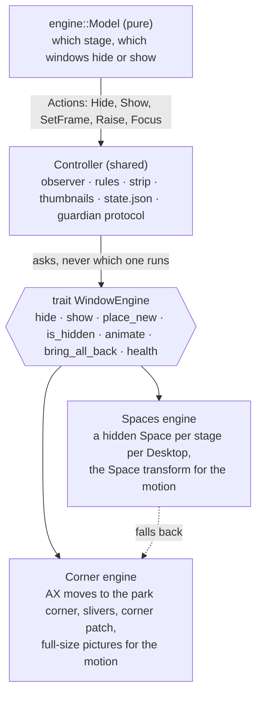
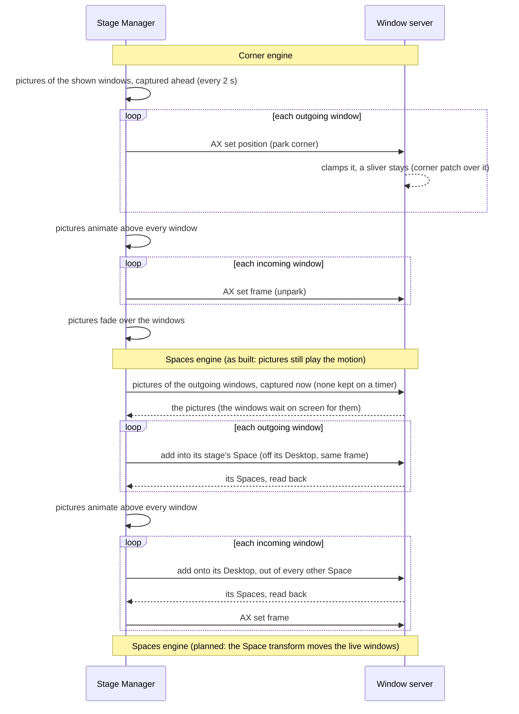

# Stage Manager — architecture

How the app is built and the rules the code keeps. What it should do for the user is in
[UX-SPEC.md](UX-SPEC.md); building and testing in [DEVELOPMENT.md](DEVELOPMENT.md); what is
still to do in [PLAN.md](../PLAN.md).

App: `Stage Manager.app`, bundle ID `dev.eugene.stagemanager`, `LSUIElement`, binary
`stage-manager`, crate `stage_manager`. A floating-window stage manager: Apple's strip and
floating windows, no tiling, no grids, no snapping; every window keeps the frame the user
gives it. The defaults look and behave like Apple's; every extra is off until configured.

## Architecture

```text
main thread (AppKit)          WM thread (CFRunLoop)            helpers
─────────────────────         ──────────────────────           ──────────────────────
NSApplication run loop        AXObservers (all apps)            capture: window server, SCK
status item + menu            AX reads/writes (timeout 0.25s)   config watcher (mtime poll)
strip NSPanels                engine::Model (owns state)        signal watcher (self-pipe)
Carbon hotkeys        ──cmd──▶ executes engine Actions          guardian process (parent death)
NSWorkspace notifications     persists state.json               ctl socket (testing/scripting)
              ◀──snapshot───  StripModel to main via GCD
```

- **Stages per screen and Space**, as Apple's (UX-SPEC "Screens"). Each screen has its own
  strip, Spaces, park corner (one with no screen beyond it, `engine::corner::park::choose_corner`)
  and capacity. A window belongs to the screen showing most of it (`engine::displays`);
  moved to another it starts a stage there (`Model::windows_moved_to_display`); a removed
  screen hands its stages to the main one (`Model::set_displays`). Screens are known by
  vendor, model and serial (`ScreenKey`), never `CGDirectDisplayID`, in the model and in
  `state.json`. `[displays] main_only` (read at launch) keeps the main screen only. Inactive
  stages are parked in their screen's corner. A switch saves the active stage's frames and
  z-order, parks it, restores the target's, raises, focuses the remembered key window last.
  Nothing acts on another Space's windows except the safety paths.
- **Spaces by their windows.** No public API names a Space: each gets a synthetic id,
  recognized on `activeSpaceDidChangeNotification` from the window server's on-screen list.
  A window reaches the engine only once it shows on a display. A once-a-second check
  catches Space moves and missed notices. No SkyLight/CGS calls.
- **Engine is pure Rust** (`src/engine`, `src/config.rs`), unit tested: observations
  in, `Action`s out (`Hide`, `SetFrame`, `Raise`, `Focus`).
- **Platform layer** (`src/platform`): AX, CGWindowList, ScreenCaptureKit, Carbon hotkeys,
  NSWorkspace events, safety. Public APIs only, plus `_AXUIElementGetWindow`.
- **UI** (`src/ui`): status item and menu, Settings, a strip panel per screen (CALayer
  cards), the motion overlay (just below floating windows; above everything only while a
  dragged window's card shows).
- **Threads:** every AX call runs on the WM thread with a 0.25 s timeout; the main thread
  never calls AX. Apps that do not answer yet (a login, the launch's recovery scan) are
  asked on threads of their own, so one busy app holds up no other. The minimize tap
  (`platform::minimize_tap`) asks on its own thread too, at 0.1 s a call and only for a press
  near a managed window's title-bar buttons or ⌘M: a minimize caught there goes to the WM
  thread as a command. Frame writes run with
  the app's `AXEnhancedUserInterface` off (`platform::enhanced_ui`), on again after (also at
  quit, panic and SIGABRT). A late activation notice acts only if it fired after our latest
  switch began and its app is still frontmost (`engine::stale_activation`). A handle answering `kAXErrorInvalidUIElement` is looked up
  afresh by id; one unlisted and off screen on two looks a second apart is let go as closed
  (`engine::stale_handle`). Commands go main → WM by channel plus `CFRunLoopPerformBlock`;
  snapshots WM → main via GCD.

## Window engines (1.9, in progress)

How a stage's windows are hidden, shown and animated is one strategy with two
implementations. The **Corner engine** is today's: Accessibility moves to the park corner,
pictures for the motion. The **Spaces engine** puts each inactive stage in a hidden Space of
the window server's own. Everything else is written once and never asks which engine runs.
The Corner engine is the default. The Spaces engine is built; a launch runs it only when
the launch probe passes and either the hidden opt-in (`STAGE_MANAGER_SPACES=1`) or the
live suite's test switch (`STAGE_MANAGER_ENGINE=spaces` in a fixture run) asks for it, until
the measurements are in (PLAN, 1.9).



A switch in each engine:



Which engine runs is decided on every Mac at every launch, never by a list of macOS
versions:

```mermaid
stateDiagram-v2
    [*] --> Corner: [windows] engine = "accessibility" (no probe)
    [*] --> Probe: "auto"
    Probe --> Spaces: the calls resolve, a trial Space with an own panel reads back, and opted in
    Probe --> Corner: a step fails, or not opted in (the verdict logged either way)
    Spaces --> Spaces: every hide and show read back; a miss sent once more
    Spaces --> BringAllBack: still missed after the retry, or 3 misses set right within 60 s
    BringAllBack --> Corner: for the rest of the run; the hidden windows parked
```



The choice is pure (`engine/engine_choice.rs`: `choose` from the config, the opt-in, the
test switch and the probe's verdict; `Health`, the strikes in their window of time) and is
made in `main` once AppKit is up and before the WM thread starts
(`window_engine::choose_at_launch`). The probe (`platform/spaces/probe.rs`) looks up the
calls, orders in a 4-point transparent panel of the app's own far off every screen (its
order-in flushed: AppKit sends it with the run loop's transaction otherwise, and the run
loop has not run yet), makes a classic Space, adds the panel into it and reads it back
hidden, adds it back onto its Desktop with the show's mask and reads it back, ends the
Space and closes the panel; each step bounded at 40 ms, the first that does not read back
is the reason. `ctl state` `engine` says `kind`, `why`, `probe` (ok, reason, ms, each step's
ms) and `fallback`. The fallback runs on the WM thread at the tick after the engine failed
(never while a switch's windows wait behind their pictures, never during a quit,
`controller/fallback.rs`): the failed engine's `bring_all_back` (the Spaces engine's sweep;
windows a refusing window server leaves in a stage Space come out by ending that Space with
the classic call, which needs no bridge), `window_engine::fall_back` installs the Corner
engine and records why, the controller takes the new engine, the model's answers follow
(`Model::set_engine`), the parked file is written again, and the windows the model counts
hidden on a Desktop shown are parked (those on another Desktop when it shows, as always).
`ctl debug-engine-fail next|hide|show|all` (test only) drives it in the live suite's
`engine` phase.

Quit, a crash (the guardian), a logout and a stand-down use the same `bring_all_back`
whichever engine runs. Each choice and fallback is logged with its reason. The parked file
of a Spaces run names its stage Spaces with their Desktops (`ParkedFile::spaces`): the
guardian's engine takes them as its own (`assume`) and its sweep moves windows out of them
if the app still holds them; after a crash they are gone already. A Spaces run's recovery
scan also runs the Corner scan when an earlier copy left registered windows, so a Corner
run that crashed with windows in the park corner is brought back the Corner way under
Spaces (the launch scan is the Corner one under either engine).

In the code so far (the seam, Corner only): the model emits `Action::Hide { id }` and never a
park frame, and asks every question about where hidden windows are through one door
(`engine/model/hiding.rs`), which asks the pure half of the engine that runs
(`ModelOptions::engine`; the Corner engine's is `engine::corner`, its geometry
`engine::corner::park`). The questions are of two kinds: is this listed window hidden now,
and may a window be brought back here. `platform::window_engine::WindowEngine` has
`hidden_at`, `hide`, `show`, `is_hidden`, `animate`, and for safety `bring_all_back`,
`bring_back_briefly` (an abort), `bring_back_rest` (the last look at the window server's
list), `recover` (the recovery scan), `stranded` (is a window read at this frame still
hidden away) and `assume` (the guardian takes the app's parked file as its own knowledge),
with `platform::corner::engine::CornerEngine` behind it. A `SetFrame` is the
engine's `show`: the model counts the window shown either way, and the engine knows what it
has hidden. `animate` answers a `Motion` on the WM thread; the controller plans the
transition, sends it to the strip and waits for its answer the same way for every motion,
and runs the choreography the motion names (`Motion::Pictures`: hides behind the outgoing
pictures, arrivals held until the unveil). The engine is one value for the process
(`window_engine::current`), so the WM thread's batches and the safety paths on other threads
ask the same one. The parked file names the engine (left out for Corner), and the guardian
installs that engine before its first scan; its watch asks that engine whether a window is
still away.

What an engine keeps up on the WM thread around those calls is not behind the trait: it
reads and changes the controller's own state (the model, the phase, the observer). It goes
through a second door, `platform/controller/upkeep.rs`: every moment the shared code has
engine work at (a batch ended, the tick and the fast tick, a press released, a show or a
hide that failed, a window let go while hidden, a switch's cover, the shows still owed at
quit, `ctl state`) is one method there with one `match` on the engine that runs, the same
shape as the model's door. The Corner engine's answers are methods of the controller in
`platform/controller/corner/` (the corner patch and the desktop's still, the inert-slivers
shield, the park reconcile, the windows whose restore failed, the switch's corner cover) on
one struct of state, `CornerUpkeep`; no other file of the controller touches it. The Corner
engine's files: `engine/corner/` (pure), `platform/corner/` (the engine, the slivers tap),
`platform/controller/corner/` (its upkeep). A new window's placement before it shows is
three questions on the trait: `app_launched` (a launch notice), `about_to_show` (the window
is held on its way in, so the controller places it now) and `let_new_out` (placed: let it
show); the Corner engine answers nothing, never and nothing. The checks while running are the
trait's `health` (the Corner engine: never failed).

The Spaces engine as built (`platform/spaces/`: `ffi.rs`, SkyLight's calls loaded at run
time, nothing linked; `engine.rs`; its pure half `engine/spaces.rs`; its upkeep
`platform/controller/spaces.rs`). One window-server Space per stage per Desktop, made by the
classic call when the stage's first window hides there, so it belongs to this process: the
window server ends it with the process and its windows show again by themselves, after a
crash or a kill. A hide is the bridged add of the window into its stage's Space; a show is
the same add into the window's own Desktop (read from the window server when it hid) with
the mask that takes it out of every kind of Space, then the frame through Accessibility
when the window is not already at it (a hide does not move a window, so most shows ask the
app nothing, and a frozen app's window hides and shows all the same). The stage Space is
never shown. A hidden window keeps its frame and is listed off screen, so
no frame says "hidden" (`is_hidden` and `stranded` answer false) and the trait has one more
question, `present_off_screen`: the windows hidden on a Desktop that shows, which every count
of a Desktop's windows adds to the on-screen list (a window gone from the screen left its
Desktop; a hidden one did not). No return code is trusted: after every hide and show the
window's Spaces are read back, a miss is logged and counted (`ctl state`, `engine`), a show
that left a window hidden is owed and tried again by the tick, and about once a second the
upkeep checks that the windows the model counts hidden are the ones in stage Spaces, and
every few seconds lets out any window found in a stage Space that the engine does not hold.
Two things the window server does not say for a window in a stage Space, so the shared code
asks otherwise: a window its app closed without a notice is listed exactly as before, so the
dead-handle look takes in the hidden windows too; and macOS shows a window it un-minimizes
on the Desktop, out of any Space, so a minimized window on its way to the strip is put
beyond the Dock's edge first, as under the Corner engine, and hidden again once it is down. The
bring-backs (quit, a stand-down, a panic, an abort) ask the window server which windows are
in the engine's Spaces and move each onto its Desktop, from any thread, then end the Spaces;
the registry still gives fitted windows their frames back. The motion is still the
pictures (`Motion::Pictures`), but none is kept fresh on a timer: the trait's
`pictures_at_switch` answers true, so the strip captures full-size pictures only as the
pointer nears a card, and the controller, before it sends a switch to the strip, captures
every outgoing window whose picture is not fresh (`platform/controller/switch_pictures.rs`,
through `platform/switch_shots.rs`: the window server's own capture a window at a time, any
window it misses through ScreenCaptureKit) and waits for them, 160 ms at most. The
windows stay on screen meanwhile and hide behind their pictures in one step each. A window
in a stage Space still draws and is captured with its current content, so an incoming
window's picture taken while it is hidden (the pointer on its card) is current too.

Window pictures (`platform/capture.rs`, `platform/capture_fast.rs`, 1.9): every capture asks
the window server first, one call a window and no listing (`SLSHWCaptureWindowList` for a
window within the displays, on screen or in a stage Space; `CGWindowListCreateImage` for one
partly off every display, a parked window), and ScreenCaptureKit only for a window that
source misses (the call missing, nothing handed back, a picture that cannot be the window),
for every picture when the first one of a call came back blank, and for a window's look read
from its shadow (one a round, each window's every 20 s at most). Card thumbnails are taken at
events, no timer (`[strip] thumbnail_interval_ms = 0`): a window newly on a card, the strip
coming into view, the pointer reaching a card; a failed one twice more, 3 s apart. The Corner
engine keeps its full-size pictures fresh every 2 s, the same way.

A newly opened app's window under the Spaces engine (`platform/spaces/launch_watch.rs`): the
window server lists it, off screen and on no Space, tens to hundreds of ms before it first
shows, and Accessibility answers the app only as it shows. So from the app's launch notice
a thread reads the window ids every 4 ms for 3 s and puts each new window of the app still
on no Space into a Space where new windows wait, never shown. The app orders it in there;
the controller finds it through Accessibility and places it at once, the switch to its
stage hides the stage left behind, and only then is it let onto the Desktop (or into its
stage's Space). A window not placed within a second of its app ordering it in, or never
ordered in (helper windows), is let out as it would have shown. Windows found together are
taken front to back, the held ones in their app's own order (its `AXWindows`: the window
server's list of a Space never shown does not keep it), so an app opening two windows ends
with the one it opened last in front; one let out while its
stage's switch still moves tells the strip (`StripSnapshot::under_now`), whose overlay goes
under it, so the stage left behind shrinks behind it.

What macOS does around hidden windows differs where it decides by the windows it counts on
a Desktop, and a window in a stage Space is on none. When the app in front quits, macOS
activates no app of a hidden stage, so the model brings the most recent stage in front
itself (`Model::front_after_quit`, through the model's door: under the Corner engine macOS's
activation of the next app does it). An activation for a window held on a Desktop not shown
takes macOS nowhere, so the app arranges that Desktop and focuses the window
(`WindowEngine::off_every_desktop`). A switch's focus on a window still in its stage Space
waits for its show only when its app has a window on a Desktop not shown, where macOS would
follow it (`WindowEngine::focus_waits_for_show`); otherwise the keyboard goes at once, as
under the Corner engine.

```mermaid
sequenceDiagram
    participant App as New app
    participant W as Launch watch
    participant WS as Window server
    participant C as Controller
    App->>WS: window created (listed off screen, no Space)
    W->>WS: ids every 4 ms; add it into the waiting Space
    App->>WS: ordered in (shows nowhere: its Space is hidden)
    C->>App: AX: the app answers, the window is found
    C->>WS: switch: the old stage's windows into their Space
    C->>WS: the new window onto the Desktop: it shows
```

## macOS settings drive behavior

Apple's settings (`com.apple.WindowManager`, re-read on change, never written) are the
source of truth wherever they exist; `config.toml` holds only what macOS lacks.

## Safety: no window stays parked

A parked window that never returns is the worst bug.

1. **Registry** of every parked window's AX element and restore frame, across Spaces.
2. **Quit** unparks everything, saves the stages, then brings back any window still in a
   park zone (registry, unpark or `state.json` frame, else centered). `CannotComplete` is
   retried on unparks only. Bounds: leftovers ≤ 4 s, registry retries ≤ 2 s. Not clean
   while a managed window is parked on any Space: the guardian takes over (the main thread
   unparks from the registry itself only when the WM thread gave no answer). A window whose
   restore failed counts as parked only while the window server lists it in a park zone
   (one at its own frame on a Desktop not shown is not: a dead handle, a full-screen
   window). A stand-down (Apple's Stage Manager turned on) ends with the same check; the
   windows it could not bring back are looked for again at each Desktop change, the
   windows parked since left alone.
3. **Panic hook** unparks (`try_lock`, falls back to the scan).
4. **SIGTERM/SIGINT/SIGHUP** through a self-pipe to a watcher thread that unparks and exits.
5. **Guardian** (`stage-manager --guardian <pid>`), restarted if it dies while the app runs:
   when the parent dies without its clean-exit marker it runs the recovery scan, then waits
   for every window still parked until it is seen back, gone (unlisted 3 s) or adopted. It
   only moves windows out of the park zone. Once a new copy reports `adopted`, it hands over
   the rest (`ctl take-watch`; an unsigned sender's only as the app sees them parked) and
   exits. A pass listing nothing on screen is blind: nothing moves. After a quit at a
   logout it waits for a cancel and reopens the app; after an unclean one (the parked file
   says `logout`) it listens through its watch, opens the app at a cancel heard then, and
   once every window is back waits as after a clean quit.
6. **Recovery scan** (launch, guardian, main display change): a window in a park zone goes
   back to a crashed copy's registered frame, else its saved frame (main display of the
   saved size only), else centered; silent apps retried 30 s, two apps a pass. A sliver
   (≤ 8 × 256 pt past the right or bottom edge) counts only for windows managed, registered
   or of apps in `state.json`.
7. **Restore frames within reach** (`Display::reach`): never in a park zone, the title bar
   below the menu bar with 80 pt on screen.

Never waited on (logged at debug): **hidden tabs** (layer 0, off screen, unlisted by an
answering app, a same-size sibling) and **other apps' helpers** (in the park zone, off
screen, unlisted, never registered, managed or saved). A managed, registered or saved
window always waits. One kind waits without making a quit unclean: a registered **child
its app ordered out while parked** (off screen in the zone, its handle dead, unlisted by
its answering app; the parked file marks it `ordered_out`). No clean-exit marker is
written, so the guardian keeps it, but the quit logs no error and the user's Quit still
installs a ready update.

## Strip order

`[strip] order`: `"native"` (default, Apple's swap with LRU eviction), `"in_place"` (stable
places per Space; `"fixed"` its old name) or `"dock"` (in-place places by each stage's
leftmost Dock app, read through AX, never mid-transition). Details: UX-SPEC and CONFIG.

## Testing hooks

`make check` stays clean. The ctl socket, `STAGE_MANAGER_ONLY` and the fixture app:
`docs/DEVELOPMENT.md`. Live phases touch fixture windows only; none while another copy's
guardian runs or the screen is locked.

## Accepted trade-offs

- **Slivers:** a window of a managed app pushed almost wholly off the bottom-right edge
  (≤ 8 × 256 pt showing) is taken as parked; a switch brings it back to its last frame.
- **Horizontal drag as a slide:** `activation_frame` (`platform/controller.rs`) reads a
  horizontal-only drag of a display's only shown window, of an app posting no move notice,
  as a Desktop slide.
- **Restore window:** up to 5 minutes after a launch (to the first click, key or card, or
  apps quiet 20 s) a window an app opens itself that matches an inactive stage's saved
  window is parked there, not switched to. When it ends, waiting entries of apps not
  running are given up; running apps keep theirs for their own quiet minute; a Desktop not
  visited keeps its own (up to 30 days).
- **Apps that save their own frames:** a window parked when its app quit may reopen at the
  park frame; within a day it gets its old frame back, else centered.
- **Logout head start:** at the first logout signal every window comes back and the stages
  are saved; the app idles until macOS's quit. A cancel resumes; with no cancel signal, two
  minutes after the latest signal or app quit. An app's quit keeps its entries two minutes.
- **One pool after a restart:** Electron apps reopen on the Desktop shown; a confident match
  of another Desktop's entry recreates its stage there. Two Desktops' same-named stages feed
  one stage (`find_named`). Nothing tells the user: macOS moves no window between Desktops.

## Still the main screen's, by design

A Space change settling and the lock gate every screen (no notice names the screen); `ctl
merge`, `ctl space`; the probes and debug hooks; the sliver shield; `ctl state`'s top-level
fields (each screen's: `displays[i]`).
